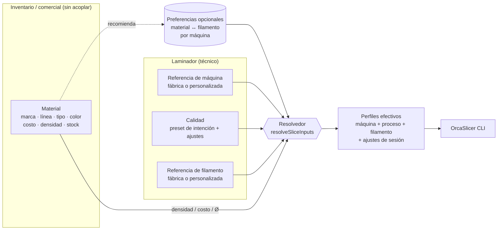

# 02 · Propuesta: simplificar Calidad y Filamento, y desacoplar el material del perfil

Resuelve: **PFC-01, 02, 04, 06, 08, 10, 11** (y completa 03, 05, 07, 09, ya parcialmente corregidos), **BIB-08** (parcialmente), base de **VIS-01** (ajustes de sesión).

> **Cómo encaja con lo ya construido** (`development` @ `54a4bc6`, ver `docs/revision-perfiles-maquinas.md`): la **boquilla** ya es una dimensión de primera clase (`machines.nozzle_setups`, `slicer_profiles.nozzle`, `lib/slicer/nozzle.ts` con reglas de altura de capa 20–70 % del diámetro, ancho de línea, espesor de pared y plantillas Borrador 60 % · Estándar 50 % · Fino 30 %). Esta propuesta **no la reemplaza: la generaliza**. Las «plantillas por boquilla» pasan de _crear filas_ a ser la **definición de los presets de calidad**, y la boquilla pasa a ser una entrada más del resolvedor.

## 1. Principios

1. **El inventario no depende del laminador.** Un material (marca, color, costo, stock) existe y se cotiza aunque nadie haya elegido un perfil técnico.
2. **Un perfil es «referencia + cambios».** Solo se guarda una fila en BD cuando el usuario _personaliza_ algo (copy-on-write). Usar un perfil de fábrica tal cual no crea registros.
3. **Calidad es una intención, no un archivo.** «Borrador / Estándar / Fino / Resistente» se _resuelve_ al momento de laminar según la máquina; no se guarda una copia por impresora.
4. **Nada bloquea por falta de configuración.** Si falta algo, el sistema elige un valor razonable, lo **muestra** («Filamento: Generic PETG · automático») y deja cambiarlo con un clic.
5. **Una sola fuente de verdad** para densidad, costo y diámetro: el material. El laminador las recibe como _sobrescrituras_ al construir el perfil efectivo.

## 2. Modelo conceptual propuesto



### 2.1 `ProfileRef`: referencia en vez de fila

```ts
type ProfileRef =
  | { kind: 'factory'; type: 'machine'|'process'|'filament'; name: string; vendor?: string }  // sin fila en BD
  | { kind: 'custom';  id: string };                                                          // fila en slicer_profiles
```

- Elegir «0,20 mm Standard @BBL A1» guarda solo la referencia (`kind:'factory'`).
- «Personalizar» crea una fila `slicer_profiles` (ya existe) con `baseName` + `changes`, y la referencia pasa a `kind:'custom'`.
- `slicer_profiles` queda como **«Perfiles avanzados»**: solo lo personalizado/importado. Se acaba el ruido de copias con 0 cambios (PFC-02).

### 2.2 Calidad (`quality_presets`) — nuevo (generaliza las plantillas por boquilla)

| Campo | Descripción |
|---|---|
| `name`, `icon`, `sort`, `is_system` | «Borrador», «Estándar», «Fino», «Resistente» (sistema, editables) + los que cree el taller |
| `intent` | `draft` \| `standard` \| `fine` \| `strong` \| `custom` |
| `layer_height` | Altura objetivo, expresada **como fracción del diámetro de boquilla** (Borrador 60 % · Estándar 50 % · Fino 30 %, las mismas reglas de `lib/slicer/nozzle.ts`) para que el preset sirva con 0,2 · 0,4 · 0,6 · 0,8 · 1,2 mm |
| `overrides` (jsonb) | Claves Orca a imponer: `wall_loops`, `sparse_infill_density`, `sparse_infill_pattern`, `top_shell_layers`, `enable_support`… |
| `speed_factor` (opcional) | Multiplicador de velocidades sobre el proceso base |

**Resolución a proceso concreto** (en servidor, al laminar):

1. Tomar `processesFor(machineBase)` (ya existe en `lib/slicer/setup.ts`) → procesos de fábrica compatibles con esa impresora **y la boquilla puesta**. Si no hay perfil de fábrica para ese diámetro (p. ej. 1,0 · 1,2 mm), usar la **plantilla de `nozzle.ts`** (reescala velocidades y anchos de línea, como ya hace hoy «Plantillas por boquilla») en memoria, sin crear filas.
2. Elegir el de altura de capa más cercana a `layer_height` y, a igualdad, el de `intent` más afín (Standard/Strength/Quality/Speed; el heurístico ya existe en `processesFor`).
3. Aplicar `overrides` encima → perfil de proceso efectivo.

Resultado: el mismo preset «Fino» funciona en una A1, una P1S o una Prusa sin duplicar perfiles, y filtra el problema de compatibilidad (PFC-03) por construcción.

### 2.3 Filamento: recomendación, no dependencia

- `materials.filament_profile_id` pasa a **deprecado** (se conserva durante la migración).
- Tabla opcional `material_profile_prefs(material_id, machine_ref?, filament_ref, source)` guarda _preferencias_ («para este PETG en la A1 uso “PETG HF”»), nunca obligatorias.
- **Resolvedor de filamento** (orden de prioridad):
  1. Selección explícita en el momento (estudio/panel/línea).
  2. Preferencia `(material, máquina)`.
  3. Preferencia `(material)`.
  4. Sugerido automático (`suggestFilamentBase`: marca+tipo+línea → perfil de fábrica de la marca).
  5. Genérico por tipo (`Generic PETG @System`), con aviso visible.
- **Inyección de datos comerciales:** el perfil efectivo recibe `filament_density`, `filament_cost`, `filament_diameter` desde el material → una sola fuente de verdad y gramos coherentes entre laminador y estimador (PFC-04).
- **Laminar «sin material»**: se puede elegir un filamento de fábrica _sin_ pertenecer al inventario («explorar perfiles»), y por separado indicar «material para costo» (si no, costo 0 con aviso).

### 2.4 Máquina

- `machines.machine_profile_id` → `machine_ref` (`ProfileRef`); `default_process_profile_id` → `default_quality_id`. Con la boquilla ya modelada, `machines.nozzle_setups` pasa de `{boquilla → {machineProfileId, processProfileId}}` a `{boquilla → {machine_ref, default_quality_id}}` (mismo diseño, referencias en lugar de ids de fila).
- El asistente solo pide **qué impresora es y qué boquilla tiene puesta** (se sugiere por marca/modelo; ya existen `suggestMachineBase` y el selector de boquillas). `ctx.setups` (máquina × boquilla) sigue siendo la opción que ven Laminar y Comparador.

### 2.5 Datos de una corrida (`slice_runs`)

Se añade `inputs jsonb`: `{ machineRef, processRef|qualityId, filamentRef, materialId?, overrides:{process,filament,machine}, sources:{filament:'auto|pref|manual', …} }` y `effective_hash`. El `cache_key` incorpora `overrides`. Los campos actuales (`machine_profile_id`, …) se mantienen durante la transición.

## 3. Impacto en pantallas

| Pantalla hoy | Cambio |
|---|---|
| `/laminador/configurar` (3 pasos) | Pasa a **«Impresoras»** (1 paso). Filamentos y calidades desaparecen como obligaciones; el paso 2 se vuelve una lista opcional de _preferencias_ dentro del mantenedor de materiales. |
| `/laminador` → Perfiles (3 tablas) | Se reemplaza por **«Mis perfiles»** (solo personalizados/importados) con buscador, filtro por tipo/máquina, etiqueta «Basado en…», diff vs fábrica y «Usado en» accionable. Pestaña nueva **«Calidades»** (presets). |
| `slice-panel.tsx` / `comparator.tsx` / `line-editor.tsx` | Selectores de **Calidad** y **Filamento** con compatibilidad ya resuelta; etiqueta de origen («automático»). Se acaba el filtro `m.filamentProfileId`. |
| `inventory-bits.tsx` (MaterialForm) | Se quita el selector de perfil como campo principal; sección colapsada «Ajustes de laminado» con la preferencia (opcional). |
| `ProfileEditor` | Rediseñado como editor por secciones (ver `04-estudio-de-laminado.md` §3.2) y reutilizado dentro del Estudio. |

Sugerencia de UI para el selector de calidad (ejemplo):

```
Calidad    ( Borrador 0,28 )  ( ● Estándar 0,20 )  ( Fino 0,12 )  ( Resistente )  [ + Personalizar ]
           Estándar · 0,20 mm · 2 paredes · 15 % relleno   → «0.20mm Standard @BBL A1»  [Ver / ajustar]
```

## 4. Reglas de integridad (completa PFC-05)

- **Ya existe** la guarda de borrado (`lib/slicer/usage.ts`): bloquea y dice quién usa el perfil. Se **extiende** para (a) cubrir líneas de presupuesto/pedido y productos _(por verificar qué consulta hoy)_, y (b) ofrecer **reemplazar por…** o **archivar** en lugar de solo bloquear.
- Las referencias `factory` pueden quedar «huérfanas» si cambia la versión de Orca; el resolvedor avisa («el perfil ya no existe en OrcaSlicer 2.5; se usó el más cercano») y registra la sustitución en la corrida.

## 5. Plan de migración (expandir → migrar → contraer)

1. **Expandir:** crear `quality_presets`, `material_profile_prefs`, columnas `*_ref`/`inputs` (nullables). Ninguna ruptura.
2. **Backfill (script idempotente):**
   - `machines.machine_profile_id` y cada entrada de `machines.nozzle_setups` → `machine_ref` (`custom` si el perfil tiene cambios; `factory` si no).
   - Procesos con 0 cambios → `factory`; con cambios → crear un preset de calidad «Personalizado: …» que referencia su `overrides` o mantener `custom`.
   - `materials.filament_profile_id` → `material_profile_prefs` (origen `manual`).
   - Perfiles `custom` con 0 cambios y sin uso → archivar tras confirmación del usuario (lista previa; **nunca** automático).
3. **Migrar código** (`setup.ts`, `queue.ts`, `actions/slicer.ts`, `context.ts`, paneles) al resolvedor; mantener lectura de campos viejos como _fallback_.
4. **Contraer** (release posterior): eliminar columnas/relaciones antiguas.

Compatibilidad: los `slice_runs` históricos conservan `profile_versions` (snapshot) y siguen siendo válidos para presupuestos ya enviados.

## 6. Pruebas

- Unitarias: resolvedor de filamento (5 niveles), resolución calidad→proceso por (máquina, boquilla) (Bambu A1/P1S, Prusa MK4S, Creality; boquillas 0,2 · 0,4 · 0,6 · 1,2), inyección de densidad/costo, compatibilidad. Reutilizar casos de `tests/unit/nozzle.test.ts` y `tests/integration/nozzles.test.ts`.
- Integración: backfill sobre la semilla de demo; corrida con filamento genérico sin preferencia; borrado con y sin uso.
- E2E a actualizar: `02-laminador`, `12-laminado-config`, `15-perfiles-boquillas`, `03-presupuesto` (selectores).
- i18n: cada etiqueta nueva (calidades, orígenes «automático/preferencia/manual», avisos) en `src/i18n/es` y `src/i18n/en`.
- Riesgo principal: **nombres de perfiles de fábrica** cambian entre versiones de Orca → el resolvedor debe ser tolerante y probado contra el árbol real instalado (`scripts/install-orca.sh` fija 2.4.2).

## 7. Decisiones que necesito de ti

| # | Decisión | Recomendación |
|---|---|---|
| D1 | ¿Eliminar del todo `materials.filament_profile_id` o conservarlo como «preferencia»? | Conservar como preferencia opcional (tabla de prefs) |
| D2 | ¿Calidades **independientes de la máquina** (presets de intención)? | Sí; los perfiles de proceso por máquina pasan a ser un detalle interno |
| D3 | ¿Mantener las temperaturas como texto libre en el material? | No: mostrarlas desde el perfil resuelto (solo lectura) |
