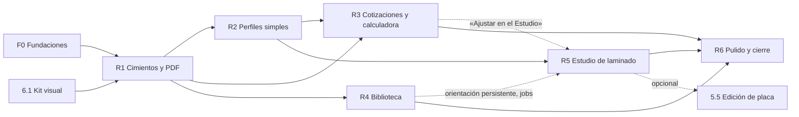

# 09 · Plan por fases y estimaciones

## 1. Supuestos y cómo leer las cifras

- **Unidad:** _jornada_ = 1 persona-día de ≈ 6 h efectivas de desarrollo. Incluye: implementación, pruebas (unitarias/integración, actualización de e2e), ajuste visual (claro/oscuro, móvil) y revisión de código. **No incluye:** QA manual del usuario, datos de producción, despliegue ni capacitación.
- **Tres cifras por paquete:** optimista / probable / pesimista. Son estimaciones de orden de magnitud (± 30 %) hechas **sin ejecutar la app ni los spikes**; se refinan tras los spikes S1–S5 (doc 04) y la validación de decisiones (README).
- **Contingencia:** no incluida; se sugiere **+15 %** sobre el total probable.
- **Una sola persona desarrolladora**, sin asumir aceleración por asistentes de IA. El orden y las dependencias importan más que la fecha.
- **Sin cambios de alcance de producto** más allá de lo documentado en `02`–`08`.

## 2. Paquetes de trabajo (WP)

### Fase 0 · Fundaciones y arreglos rápidos

| WP | Descripción | Hallazgos | Opt. | Prob. | Pes. |
|---|---|---|---:|---:|---:|
| 0.1 | `loading.tsx` / `error.tsx` / `not-found.tsx` y esqueletos por sección | UX-01 | 1 | 1,5 | 2 |
| 0.2 | Bloqueo/reemplazo al eliminar perfiles y materiales en uso | PFC-05 | 0,5 | 0,75 | 1 |
| 0.3 | Filtros de compatibilidad en selectores (proceso/filamento por máquina) | PFC-03 | 1 | 1,25 | 1,5 |
| 0.4 | Aviso «orientación solo de prueba» y arreglos de copy (resultado, calculadora) | BIB-08, VIS-07, CAL-01 | 0,5 | 0,5 | 1 |
| 0.5 | Salud del sistema (Orca/Chromium/ffmpeg), fallo explícito del PDF, `playwright` a `dependencies`, Dockerfile sin `\|\| true` | PDF-01/02, TEC-03, OM-01 | 1 | 1,25 | 1,5 |
| 0.6 | Iconografía unificada con `lucide-react` | UX-05 | 1 | 1,5 | 2 |
| 0.7 | Campo de fecha es-CL | UX-06 | 0,5 | 0,75 | 1 |
| | **Subtotal F0** | | **5,5** | **7,5** | **10** |

### Fase 1 · Desacople de perfiles, filamentos y calidad (doc 02)

| WP | Descripción | Opt. | Prob. | Pes. |
|---|---|---:|---:|---:|
| 1.1 | Modelo de datos (`ProfileRef`, `quality_presets`, `material_profile_prefs`, `inputs` en corridas), migración «expandir», script de backfill | 4 | 5 | 6 |
| 1.2 | Resolvedor (`resolveSliceInputs`) y refactor de `setup.ts`, `queue.ts`, `actions/slicer.ts`, `context.ts` | 2 | 2,5 | 3 |
| 1.3 | UI de Calidad (presets, selector, edición) | 2 | 2,5 | 3 |
| 1.4 | «Mis perfiles»: lista unificada, diff vs. fábrica, copy-on-write, uso accionable; unificar importación | 2 | 2,5 | 3 |
| 1.5 | Simplificar «Configurar laminado» → «Impresoras» | 1 | 1,25 | 1,5 |
| 1.6 | Pruebas (resolvedor, backfill, integración, e2e 02/03/12) | 2 | 2,5 | 3 |
| | **Subtotal F1** | **13** | **16,25** | **19,5** |

### Fase 2 · Biblioteca de modelos 3D (doc 03)

| WP | Descripción | Opt. | Prob. | Pes. |
|---|---|---:|---:|---:|
| 2.1 | Importación: cola `jobs`, hash previo y decisión de duplicados, multi-subida, ZIP/carpeta, metadatos por lote, 3MF multi-objeto | 3 | 4 | 5 |
| 2.2 | Listado: filtros en URL, paginación por cursor, etiquetas/carpetas normalizadas, selección múltiple y acciones masivas, vista lista | 3 | 4 | 5 |
| 2.3 | Miniaturas turntable e insignias («cabe», «N laminados», «usado en…») | 2 | 2,5 | 3 |
| 2.4 | Detalle unificado (pestañas sin recarga, «¿Cabe?» real, versiones comparables, orientación persistente) | 2 | 2,5 | 3 |
| 2.5 | Procesamiento persistente y reanudable (sobre `jobs`) | 1 | 1,5 | 2 |
| | **Subtotal F2** | **11** | **14,5** | **18** |

### Fase 3 · Cotizaciones y PDF (doc 05)

| WP | Descripción | Opt. | Prob. | Pes. |
|---|---|---:|---:|---:|
| 3.1 | Listado: KPIs, segmentos, fila rica, tablero opcional | 2 | 2,5 | 3 |
| 3.2 | Detalle: stepper, pestañas, líneas ricas, costos en capas, versiones con diff, actividad | 4 | 5 | 6 |
| 3.3 | Editor: Editar/Vista cliente/dividida, panel de totales, simplificación del precio, `LineEditor` modular, typeahead | 3 | 4 | 5 |
| 3.4 | **PDF v2:** `<QuoteDocument>` único, diseño, navegador persistente, snapshot almacenado, opciones | 4 | 5 | 6 |
| 3.5 | Pruebas (PDF golden, paginación, permisos, e2e 03/06/07/08) | 1,5 | 2 | 2,5 |
| | **Subtotal F3** | **14,5** | **18,5** | **22,5** |

### Fase 4 · Calculadora y mantenedores (doc 06)

| WP | Descripción | Opt. | Prob. | Pes. |
|---|---|---:|---:|---:|
| 4.1 | Calculadora v2 (barra de costos, escalera, inverso, «¿y si…?», escenarios) | 4 | 5 | 6 |
| 4.2 | Mantenedor de filamentos v2 (tarjetas/carretes, Drawer, fuente única densidad/costo; agrupación por línea opcional) | 3 | 4 | 5 |
| 4.3 | Ficha de máquina: pestaña «Laminado» y estado | 1 | 1 | 2 |
| | **Subtotal F4** | **8** | **10** | **13** |

### Fase 5 · Estudio de laminado (doc 04)

| WP | Descripción | Opt. | Prob. | Pes. |
|---|---|---:|---:|---:|
| 5.0 | Spikes S1–S5 (flags de CLI, esquema de parámetros, tiempos, 3MF construido, parser de G-code) | 3,5 | 4 | 4 |
| 5.1 | Núcleo: layout, esquema ≈120 parámetros + fallback, ajustes de sesión, re-laminado con debounce/cancelación, KPIs con deltas, «guardar como perfil», orientación aplicada vía 3MF | 10,5 | 13 | 16 |
| 5.2 | Visor de G-code v2 (tipos reales, modos de color, leyenda con tiempos, sin muestreo, A/B) | 6 | 7,5 | 9 |
| 5.3 | Exploración (barridos, rejilla, gráfico tiempo–gramos–precio, Pareto) reemplazando el Comparador | 4 | 5 | 6 |
| 5.4 | Worker aislado, prioridades, cancelación, SSE | 3 | 3,5 | 4 |
| | **Subtotal F5 (núcleo)** | **27** | **33** | **39** |
| 5.5 | _Opcional:_ edición de placa (multiobjeto, gizmos, ordenar/orientar, cama real, ajustes por objeto) | 10 | 12,5 | 15 |

### Fase 6 · Sistema visual transversal (doc 07)

| WP | Descripción | Opt. | Prob. | Pes. |
|---|---|---:|---:|---:|
| 6.1 | Kit base (Select rico, Tabs cliente, Drawer, Segmented, DataTable, Stat/Delta, LayerBar, Spool, Skeleton/Empty, Toast con acción, `Kbd`/paleta de acciones) | 5 | 6 | 7 |
| 6.2 | Barrido en pantallas restantes (clientes, pedidos, cola, máquinas, ventas, galería, reportes, configuración) | 6 | 7,5 | 9 |
| 6.3 | Regresión visual automática, a11y y móvil | 2 | 2,5 | 3 |
| | **Subtotal F6** | **13** | **16** | **19** |

## 3. Totales

| Alcance | Optimista | **Probable** | Pesimista | Probable +15 % |
|---|---:|---:|---:|---:|
| Fases 0–6, **sin** edición de placa (5.5) | 92 | **115,75** | 141 | ≈ 133 |
| Con 5.5 | 102 | **128,25** | 156 | ≈ 147 |

Referencia de calendario con una persona (20 jornadas productivas/mes): ≈ 5,8 meses (probable, sin contingencia) · ≈ 6,7 meses (con 15 %).

## 4. Entregas sugeridas (releases)

| Release | Contenido | Opt. | **Prob.** | Pes. | Valor visible |
|---|---|---:|---:|---:|---|
| **R1 · Cimientos y PDF** | F0 completa + WP-6.1 (kit) + WP-3.4 (PDF v2) | 14,5 | **18,5** | 23 | PDF presentable y fiable; sin pantallas en blanco; íconos y fechas correctos; salud del sistema |
| **R2 · Perfiles simples** | F1 completa + WP-4.2 (filamentos v2) | 16 | **20,25** | 24,5 | Calidad y filamento simples; materiales independientes del perfil |
| **R3 · Cotizaciones y calculadora** | WP-3.1, 3.2, 3.3, 3.5 + WP-4.1 | 14,5 | **18,5** | 22,5 | Gestor de cotizaciones con detalle completo; calculadora v2 |
| **R4 · Biblioteca** | F2 completa | 11 | **14,5** | 18 | Importación robusta, biblioteca escalable |
| **R5 · Estudio de laminado** | F5 núcleo (5.0–5.4) | 27 | **33** | 39 | Slicer configurable embebido con exploración |
| **R6 · Pulido y cierre** | WP-6.2, 6.3, 4.3 | 9 | **11** | 14 | Consistencia visual total y regresión automática |
| | **Total** | **92** | **115,75** | **141** | |

### Dependencias

- **R2 antes de R5:** el Estudio usa el resolvedor, las calidades y las referencias de perfil.
- **R4 aporta a R5:** cola `jobs` (2.1/2.5) y orientación persistente (2.4).
- **R1 primero:** entrega valor rápido (PDF) y deja el kit visual para el resto.
- R3 y R4 son independientes entre sí; se pueden intercambiar según prioridad comercial.

### Orden alternativo (si se prioriza lo más visible para clientes)
R1 → R3 (sin la parte de calidad/filamento nueva; adaptada al modelo actual) → R2 → R4 → R5 → R6. Costo: parte de R3 se rehace al llegar R2 (≈ +2–3 jornadas).

## 5. Riesgos del proyecto

| Riesgo | Prob. | Impacto | Mitigación |
|---|---|---|---|
| Latencia/flags del CLI de Orca distintos a lo esperado | Media | Alto (R5) | Spikes S1–S5 **antes** de comprometer R5; alcance por niveles (A/B) |
| Migración de perfiles/materiales con datos reales | Media | Alto (R2) | Expandir→migrar→contraer; backfill idempotente con vista previa; respaldo previo (existe `/api/backup`) |
| Rediseño parcial deja pantallas «de dos épocas» | Alta | Medio | Kit pequeño primero + barrido final (6.2) + regresión visual |
| Fragilidad de e2e por rediseño | Alta | Medio | Mantener `data-testid` donde sea posible; actualizar specs en cada release |
| PDF: Chromium no disponible en algún entorno | Media | Medio | Fallo explícito, _healthcheck_, alternativa «versión imprimible» visible |
| Cambios de perfiles de fábrica al actualizar Orca | Media | Medio | Resolvedor tolerante + prueba de contrato (OM-20) |
| Alcance creciente en el Estudio («que sea igual a Bambu Studio») | Alta | Alto | Documento 04 §1 como contrato de alcance; D7 |

## 6. Criterios de aceptación por release (resumen)

- **Calidad técnica:** `npm run typecheck`, `npm test` y `npm run test:e2e` en verde; axe sin violaciones nuevas.
- **Datos:** migraciones reversibles o con respaldo; sin pérdida de presupuestos/pedidos/corridas históricas.
- **UX:** pantallas en claro/oscuro, escritorio y móvil con capturas actualizadas en `docs/reporte`.
- **Rendimiento:** listas de 1 000 elementos fluidas; ningún bloqueo de la web durante laminado (R5).
- **Documentación:** README y `docs/mejoras` actualizados con lo realmente implementado.

## 7. Quick wins sin dependencias (≤ 1 jornada cada uno)

1. Bloquear eliminación de perfiles en uso (WP-0.2).
2. Filtrar procesos/filamentos por compatibilidad en selectores (WP-0.3).
3. Aviso «orientación solo de prueba» en el visor (WP-0.4).
4. Fallo explícito del PDF y `playwright` a `dependencies` (WP-0.5).
5. Color de marca del PDF alineado y logo en el encabezado (adelanto parcial de 3.4, ≈ 0,5 d).
6. Corregir copy del resultado de laminado y tarjeta «¿Cabe en mis máquinas?» (WP-0.4 / 2.4 parcial).
