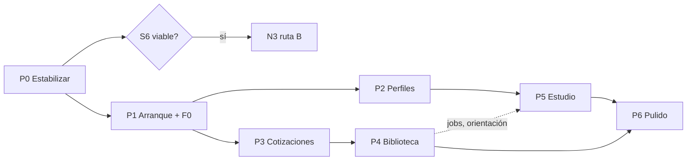

# 14 · Plan para implementar lo pendiente

Parte del registro de [`13-pendientes.md`](13-pendientes.md) y de una **revisión del hub en funcionamiento** (build de `development`, base de demostración, administrador). Solo documentación: no se implementó nada.

**Unidad:** jornada ≈ 6 h de una persona. Cifras **optimista / probable / pesimista**, ±30 %. No incluyen lo opcional (nivel B de placa, N7b, widgets) ni la calculadora fases 2–5, que dependen de decisiones del equipo.

## 1. Cómo se revisó
- Se recorrieron 37 pantallas (incluye 12 pestañas de Configuración) en escritorio (1360 px) y móvil (390 px) con sesión de administrador: estado HTTP, errores de consola, desborde horizontal, tiempo de carga y capturas. Se probaron a mano los selectores del Estudio por máquina y la guarda de borrado.
- **Resultado general:** ninguna pantalla devolvió error HTTP ni desborde horizontal; todas cargan en menos de 1,4 s con los datos de demostración. Los «errores» de consola eran prefetch cancelados al navegar (ruido). El problema no es que algo esté roto, es que falta alcance y hay puntos de fricción concretos.

## 2. Hallazgos verificados hoy, por módulo
| Módulo | Qué se ve hoy | Qué falta o molesta |
|---|---|---|
| **Inicio** | Taller en vivo, accesos rápidos, vencimientos, indicadores del mes, 9 alertas | Las alertas mezclan stock de materiales, productos y presupuestos en una sola lista sin agrupar ni priorizar; «por reponer (0 u.)» aparece igual que los críticos |
| **Pedidos** | Lista filtrable, estado y pago como insignias, fecha vencida en rojo | Sin vista por estado/tablero; sin acciones rápidas desde la fila |
| **Presupuestos** | Tablero de KPIs, filas ricas, vista tabla recordada, detalle por línea, vista cliente | Sin kanban, sin comparación de versiones, sin pestaña de actividad, sin recordatorios configurables |
| **Calculadora** | Calculadora rápida y modelo neto opcional | El modelo histórico sigue por defecto en instalaciones existentes; no hay «recalcular con tarifas actuales» |
| **Clientes** | Lista y ficha | Sin hallazgos nuevos en esta revisión |
| **Archivos 3D** | Rejilla con insignias, selección múltiple, ZIP, origen/licencia, AMS | El duplicado se avisa **después** de subir (ya creó la ficha); el análisis de cada versión corre en el proceso y **no se reanuda tras un reinicio** (no hay recuperación de versiones en «processing»); sin papelera, colecciones ni carpetas como árbol |
| **Laminador** | Tres tablas crudas (impresora, calidad, filamento) con «Eliminar» destacado; Comparador; historial | **Los selectores de calidad no filtran por máquina:** la Ender y la Prusa ofrecen las 7 calidades, incluidas las de la A1 (verificado en el Estudio). Pantalla de perfiles sin diff contra fábrica ni «usado en» accionable |
| **Estudio** | Funciona de punta a punta con Orca real | Cada carga lanza dos laminados (base y actual); sin progreso real (consulta cada 700 ms); sin orientación automática; el asesor de IA aún crea perfiles «fantasma» |
| **Cola** | Tablero por máquina y Gantt | La máquina de resina aparece como columna junto a las FDM; 4 columnas de grilla con 3 máquinas deja un hueco |
| **Máquinas** | Fichas, mantenimiento, tarjeta de laminado | «Éxito —» sin datos de trabajos; sin acceso directo desde la ficha al Estudio |
| **Inventario** | Materiales, otros, compras, alta rápida, proveedores | Borrar un material no mira líneas de presupuesto ni productos (la guarda solo cubre bobinas y trabajos activos) |
| **Catálogo / Ventas** | Operativos | Sin hallazgos nuevos |
| **Galería** | Vacía con los datos de demostración | Estado vacío correcto; sin datos para evaluar el filtrado |
| **Reportes** | 7 pestañas, filtros, CSV/Excel/PDF | La barra de pestañas se corta en pantallas medianas («Tiempos de entreg…»); solo tablas, **sin gráficos** |
| **Configuración** | 12 pestañas (documentos, proveedores, sistema, paleta) | Pestañas largas sin agrupar; el asistente no se puede re-ejecutar |
| **Transversal** | Paletas, modo oscuro, i18n es/en | Colores literales (`emerald-`, `amber-`, `red-`, `slate`) no siguen la paleta; sin kit de componentes compartido |

## 3. Plan por fases

Orden pensado para reducir riesgo primero, entregar valor visible pronto y dejar lo bloqueado para el final. Cada fase termina con `development` verde (unitarias, integración, e2e y regresión).

### P0 · Estabilización y verificación — 3 / 4 / 5,5 j
| Tarea | Cómo | Criterio de aceptación |
|---|---|---|
| Fallos e2e `13-ia` y `14-asesor-ia` | Reproducir 10 veces en solitario y en suite; si es intermitente, quitar la dependencia de orden (estado de IA persistido entre pruebas) y esperar la hidratación; si es real, corregir | 10 corridas seguidas en verde |
| Desborde en `/notificaciones` y `/cola` | Reproducir con la base e2e (no con la limpia) y ubicar el elemento que excede | `19-regresion` sin desbordes |
| Foco por teclado en regiones con scroll | Re-correr la regresión sobre la corrección ya subida | Sin `scrollable-region-focusable` |
| S6 MakerWorld | Ejecutar `scripts/spikes/s6-makerworld.sh` desde un equipo con acceso; guardar respuestas reales como fixtures | Informe con formato, límites y comportamiento de la descarga |
| Recuperación de análisis pendiente | Al iniciar, volver a procesar versiones en `processing` (corrige hallazgo de Archivos) | Prueba de integración: reinicio simulado |
| Pestañas de Reportes | Permitir envoltura o desplazamiento con indicador | Sin texto cortado a 768–1360 px |

### P1 · R1: cierre del arranque y de los arreglos rápidos — 12 / 15 / 20 j
1. **Asistente** (3 j): modo Rápido (pasos 0–3) y Completo con selector inicial; paso de datos de demostración (apagado por defecto); re-ejecución desde Configuración. *Pruebas:* e2e de ambos modos y de reanudar.
2. **F0.2 guarda de borrado** (2 j): extender `removalInfo` a materiales/perfiles con líneas de presupuesto, pedidos y productos; ofrecer «reemplazar por…» y archivar. *Pruebas:* integración por tipo.
3. **F0.3 compatibilidad** (1,5 j): filtrar calidad y filamento por máquina y boquilla en Laminar, Comparador, Estudio y líneas de presupuesto; mostrar «otras» en un grupo aparte. *Pruebas:* la Ender no lista calidades de la A1.
4. **F0.4 copy** (0,5 j) y **F0.6 iconos** (2 j): barrido con `lucide-react`.
5. **Kit de componentes** (6 j, primera tanda): adoptar Radix/shadcn para Dialog, Select, Tabs, Dropdown y Switch; migrar el modal propio y las pestañas; el resto, por pantalla en P6. *Riesgo:* convivencia con `.btn/.input/.card` (mantener ambos).

### P2 · R2: perfiles y filamentos — 15 / 20 / 27 j
1. **Contraer el vínculo heredado** (2 j): migración con vista previa y respaldo previo (`/api/backup`), luego quitar la columna.
2. **`quality_presets` + `ProfileRef` + backfill** (6 j): expandir → migrar → contraer, idempotente, sin borrar perfiles automáticamente.
3. **`filament_lines`** (5 j): agrupación real por marca/línea, edición masiva de costo y stock mínimo, sección «Ajustes de laminado» del material.
4. **«Mis perfiles»** (3 j): solo personalizados e importados, diff contra fábrica, «Usado en» accionable; «Eliminar» deja de ser el botón principal.
5. **Calculadora** (3 j): «recalcular con tarifas actuales» con vista previa y perfil «Heredado» como entidad.
6. **Proveedores** (1 j): flujo para marcar verificado y registrar fecha y quién; la verificación de los datos la hace el equipo.

### P3 · R3: cotizaciones — 9 / 11,5 / 15 j
Kanban de presupuestos (3 j, solo transiciones válidas) · diff entre versiones (2,5 j) · pestaña de actividad desde `activity_log`/`contact_log` (2,5 j) · «Ver detalles» como página imprimible (1 j) · seguimiento configurable con recordatorios y registro del envío (2,5 j).

### P4 · R4: biblioteca — 28 / 35 / 46 j
| Bloque | Tareas | j (prob.) |
|---|---|---:|
| Cola de procesamiento | Tabla `jobs` genérica con reanudación, reintentos y error legible; migrar `processVersion`, miniaturas y PDF | 5 |
| Subida | Hash antes de crear la ficha y diálogo «usar existente / nueva versión / ambos» | 2,5 |
| Organización | `tags` y `folders` como tablas (árbol, conteos), papelera y archivado con restauración, colecciones | 7,5 |
| Visor y análisis | Miniatura giratoria, 3MF inteligente (objetos y placas), pintura por cara, STEP, reparación de malla | 13 |
| IA y origen | Etiquetado con imagen (con consentimiento) y política de aplicación; **N3 ruta B** (descarga con cuenta Bambu), solo si S6 la hace viable | 1,5 + 5 |

### P5 · R5: Estudio — 26 / 33 / 43 j (sin edición de placa)
1. **Progreso real** con `--pipe` (2,5 j): cola con eventos (SSE) en lugar del sondeo.
2. **Orientación** (4 j): exponer `--orient`, guardar la orientación en el modelo y aplicarla en todo laminado (cierra BIB-08).
3. **Esquema generado al instalar** (5 j): ampliar el generador de S2 (min/max y enums), generar al correr `orca:install` en el directorio de datos (AGPL: nunca versionar el texto) y conservar el curado como respaldo.
4. **Visor** (6 j): flujo, temperatura, ventilador y herramienta; viajes y retracciones; comparar A/B.
5. **Asesor de IA** (3 j): candidatos como ajustes de sesión, sin perfiles fantasma.
6. **Multicolor** (3 j): un material por ranura al laminar, con `extruder` por objeto (S7) y torre de purga.
7. **Operación** (7 j): worker aislado con prioridad interactiva > lote (4), vista rápida aproximada (2), «enviar a imprimir» y «agregar a la cola» (3, comparte con 3). La carga doble (base + actual) se reduce reutilizando caché.
- *Opcional (+14–20 j):* edición de placa. Debe hornear transformaciones en un 3MF propio con vértices soldados, porque `--rotate/--scale` fallan en Orca 2.4.2 (S1/S4).

### P6 · R6: pulido — 11 / 14 / 19 j
Tokenizar colores (`emerald-`, `amber-`, `red-`, `slate`) hacia variables semánticas `--ok/--warn/--bad` (5 j) · barrido de Clientes, Pedidos, Cola, Ventas, Galería, Reportes y Configuración: agrupar alertas de Inicio, gráficos en Reportes, pestañas agrupadas en Configuración, columna de resina separada en Cola (5 j) · regresión visual por capturas con línea base generada en CI (1 j, +1 de infraestructura). *Opcional:* Inicio con widgets (+4 j).

## 4. Totales y secuencia
| Fase | Opt. | **Prob.** | Pes. |
|---|---:|---:|---:|
| P0 Estabilización | 3 | **4** | 5,5 |
| P1 Arranque y F0 | 12 | **15** | 20 |
| P2 Perfiles y filamentos | 15 | **20** | 27 |
| P3 Cotizaciones | 9 | **11,5** | 15 |
| P4 Biblioteca | 28 | **35** | 46 |
| P5 Estudio (sin placa) | 26 | **33** | 43 |
| P6 Pulido | 11 | **14** | 19 |
| **Total** | **104** | **132,5** | **175,5** |

- **Dependencias duras:** P2 antes de P5 (resolvedor y calidades por intención); P4 `jobs` antes del progreso real y el worker aislado de P5; S6 antes de la ruta B.
- **Paralelizable:** P3 con P2; el kit de componentes (P1) con cualquier otra.

## 5. Cómo se entrega cada fase
- Una rama por fase desde `development`, integración por PR con la suite completa en verde.
- Migraciones solo aditivas hasta una fase explícita de «contraer», siempre con respaldo y vista previa.
- Toda pantalla nueva: textos es/en con prueba de paridad, a11y (axe) y regresión estructural a 360/768/1280 px en claro y oscuro.
- Definición de terminado: pruebas nuevas por feature, sin pruebas intermitentes nuevas (se corren 5 veces), y documentación actualizada en este directorio.

## 6. Riesgos
| Riesgo | Prob. | Impacto | Mitigación |
|---|---|---|---|
| Migraciones de perfiles con datos reales | Media | Alto | Expandir → migrar → contraer, vista previa, respaldo, nunca automático |
| Cambios de Orca o del CLI entre versiones | Media | Alto | Versión fijada; pruebas de contrato con el binario real; generador de esquema tolerante |
| MakerWorld bloquea o cambia la API | Alta | Medio | Ruta manual como base; ruta B solo si S6 lo permite; fixtures guardados |
| Mantener dos sistemas de componentes | Alta | Medio | Adopción por pantalla, coexistencia de `.btn/.input/.card` hasta P6 |
| Pruebas e2e intermitentes | Alta | Medio | Esperar hidratación y navegación; P0 las ataca primero |
| Carga del laminado compartida con la web | Media | Medio | Worker aislado (P5) y caché de la corrida base |

## 7. Decisiones que necesito del equipo antes de empezar
1. ¿Se ejecuta S6 y se acepta la descarga automática de MakerWorld (términos de uso)?
2. ¿Prioridad real entre P2 (perfiles), P3 (cotizaciones) y P4 (biblioteca)? Propongo P2 → P3 → P4, pero P4 (cola persistente) es la mejor base técnica.
3. ¿Se incluye el nivel B (edición de placa) o se evalúa tras usar el Estudio en producción?
4. Las 10 decisiones de `docs/spec-calculadora.md` §14, necesarias para planificar calculadora fases 2–5.
5. ¿Quién verifica los proveedores sembrados y con qué criterio?
