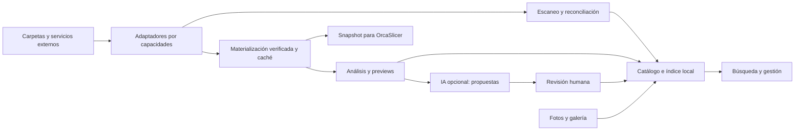

# Reporte y spec: biblioteca 3D con múltiples fuentes

**Estado original:** propuesta de diseño del 17 de octubre. Implementación y evidencia posteriores: [validación de la spec](validacion-spec-biblioteca-3d.md).
**Fecha:** 17 de octubre de 2026.  
**Base revisada:** commit `3d70f495df5cf846564d56f606e882ecfbafebad`.  
**Método:** lectura estática del código y documentación del repositorio, más consulta de documentación oficial de proveedores. No se ejecutó la aplicación ni se probaron cuentas externas. Los objetivos de rendimiento son propuestas que deberán medirse.

## 1. Resumen ejecutivo

Se propone evolucionar la biblioteca actual a un **catálogo único de modelos, versiones y ubicaciones**, capaz de indexar archivos del servidor, NAS, Google Drive y otros servicios. Cada modelo puede tener varias ubicaciones físicas y conservar sus etiquetas, fotos y vínculos con presupuestos aunque un archivo se mueva o una fuente quede desconectada.

La primera entrega útil debe incluir almacenamiento administrado actual, carpetas locales externas, Google Drive, escaneo incremental, búsqueda global paginada, gestión lógica, vistas 360 livianas y fotos reales. SFTP, FTPS/FTP y WebDAV completan la siguiente entrega; S3, OneDrive y Dropbox amplían cobertura después. La arquitectura admite todos desde el principio, pero cada adaptador se entrega con capacidades verificadas.

Tres decisiones sostienen el diseño:

1. **Catalogar no obliga a copiar todos los originales.** Se puede indexar solo metadatos y descargar bajo demanda para analizar, visualizar o laminar. La interfaz muestra qué está realmente disponible.
2. **Organización lógica y cambios físicos son operaciones diferentes.** Cambiar el título o la colección siempre puede hacerse si el usuario tiene permiso en el Hub; renombrar o mover el archivo remoto requiere capacidad y permisos del proveedor.
3. **La IA es opcional y propone cambios revisables.** El escaneo, búsqueda, geometría, previews y gestión funcionan con IA desactivada. Dimensiones, hashes y versiones se obtienen mediante código.

MakerWorld debe ofrecer desde el inicio un flujo completo de URL + metadatos recuperables + subida manual del archivo. La descarga automática queda condicionada a comprobar un mecanismo autorizado y estable; esta revisión no lo ha demostrado.

## 2. Diagnóstico del repositorio y continuidad del trabajo existente

El proyecto utiliza Next.js 15, React 19, TypeScript, Drizzle, PostgreSQL o PGlite, Three.js, Sharp y OrcaSlicer. Conserva documentación extensa de decisiones y fases previas, coherente con el mantenimiento asistido indicado por el usuario. Existe `.claude/settings.local.json`; no se encontró un `CLAUDE.md` ni un `AGENTS.md` aplicable en el repositorio o sus directorios padres revisados. Las carpetas locales `.agents` y `.codex` están vacías. Esta spec mantiene las convenciones de `docs/spec-*.md`, servicios, permisos, auditoría e i18n existentes.

### 2.1 Lo que ya existe y se debe aprovechar

| Área | Evidencia en el código | Consecuencia para la implementación |
|---|---|---|
| Modelo y versiones | `src/db/schema.ts`: `modelFiles`, `fileVersions` | Conservar sus identificadores y referencias comerciales |
| Almacenamiento | `src/lib/storage.ts`: claves relativas bajo `storageDir` | Hoy presupone un almacenamiento local; introducir resolución de ubicaciones |
| Ingesta y análisis | `src/lib/files.ts`: SHA-256, análisis, preview MFM, miniatura, ZIP y `processVersion` | Extender el pipeline; no crear una ingesta paralela |
| Cola persistente | `src/lib/jobs.ts`, `scripts/worker.ts` | Ya hay reintentos y recuperación; faltan cursores, cancelación, leases y tipos de trabajo nuevos |
| Carpetas, etiquetas y lotes | `src/lib/library/folders.ts`, `src/actions/files.ts`, `src/components/file-grid.tsx` | Carpetas actuales son rutas lógicas; no representan directorios externos |
| Búsqueda | `src/app/(app)/archivos/page.tsx` | Filtros por texto/etiqueta/carpeta/favoritos, `LIMIT = 200`, sin paginación real |
| Giro de miniaturas | `src/lib/mesh/ops.ts`: `renderTurntable` | Ya produce WebP animado de 12 cuadros, 240×180, 110 ms/cuadro |
| Límite de giro | `src/lib/files.ts` | Solo intenta generarlo hasta 400.000 triángulos; falta estrategia para modelos grandes |
| Visor y formatos | `src/lib/mesh/parse.ts`, `src/components/model-viewer.tsx` | Ya existe conversión STEP con `occt-import-js`; verificar empaquetado por plataforma |
| Reparación | `src/lib/mesh/repair-file.ts` | Ya crea una nueva versión STL: mantener el original y advertir pérdida de atributos |
| Origen web | `src/lib/library/source.ts`, `src/lib/library/import.ts` | Reconoce MakerWorld/Printables/Thingiverse y adjunta metadatos; no descarga modelos |
| IA | `src/lib/ai/features/file-tags.ts`, `src/lib/ai/run.ts`, `src/lib/library/auto.ts` | Etiquetas por IA y reglas, controles de proveedor y presupuesto; ampliar campos y revisión |
| Fotos reales | `src/lib/photos.ts`, `src/components/photo-capture.tsx`, tabla `photos` | Asociación a modelo, variantes 320/800/1600 y captura/subida con cola IndexedDB ya existen |
| Laminado | `src/lib/slicer/queue.ts` | Usa `absPath(fv.storageKey)`: necesita materializar y fijar la versión remota |
| Respaldo | `src/app/api/backup/route.ts` | ZIP en memoria con presupuesto de recorrido de 400 MiB; no sirve como respaldo completo de una biblioteca remota grande |

La documentación `docs/mejoras/03-biblioteca-modelos-3d.md` contiene descripciones anteriores a estos cambios. No volver a presupuestar como nuevas la cola, ZIP, giro, reparación o conversión STEP. Usar el código como evidencia del estado implementado; la disponibilidad real en cada instalador necesita validación posterior.

### 2.2 Brechas y riesgos concretos

- `modelSources` representa **procedencia del diseño** y licencia, no una conexión de almacenamiento. Añadir tablas nuevas para conexiones y ubicaciones, sin reutilizar esa tabla con otro significado.
- `fileVersions.storageKey` es obligatorio y local. Una versión indexada en nube puede no tener bytes locales todavía.
- La búsqueda carga todas las etiquetas para construir filtros y trunca resultados en 200. Debe consultar índices y agregaciones en servidor.
- El procesamiento lee el archivo completo y la extracción ZIP es síncrona; las bibliotecas grandes necesitan límites de memoria y aislamiento de parsers.
- Recuperar trabajos por hora de arranque, como hace la cola actual, no es suficiente si se incorporan varios workers. Se requieren propietario, heartbeat y vencimiento de lease.
- El `safeGet` actual valida DNS y redirecciones, pero obtiene `res.text()` antes de recortar el contenido. Para descargas nuevas hacen falta límites durante lectura y protección frente a resolución DNS cambiante.
- `normalizeLicense` agrupa expresiones como `personal` o `standard-digital-file` bajo `propia`; además, la ingesta usa `propia` por defecto. El nuevo importador debe conservar la licencia literal y marcar derechos desconocidos hasta contar con evidencia, sin atribuir autoría al taller.
- Las nuevas operaciones deben validar pertenencia al workspace, relación modelo-versión y permisos también en servidor. No asumir que los filtros o botones de la UI bastan.

## 3. Alcance y lenguaje del producto

| Concepto | Definición |
|---|---|
| Modelo | Ficha lógica: nombre, descripción, etiquetas, autor, licencia y relaciones comerciales |
| Versión | Revisión de contenido identificable; nunca cambia silenciosamente bajo una cotización o laminado |
| Archivo/recurso | Original, pieza de un conjunto, textura, instrucciones, foto o derivado |
| Ubicación | Presencia física de un recurso en una conexión, ruta o ID remoto |
| Fuente de almacenamiento | Configuración de acceso a carpeta, servidor, bucket o cuenta externa |
| Procedencia | Publicación original, URL, autor y evidencia de licencia |
| Carpeta de biblioteca | Organización interna que puede mezclar archivos de varias fuentes |
| Carpeta de fuente | Directorio o contenedor real del proveedor |
| Colección | Agrupación temática sin mover los archivos; un modelo puede estar en varias |

Se mantiene el alcance de herramienta interna del taller. Quedan fuera de la primera entrega un portal público, edición CAD paramétrica, sincronización bidireccional destructiva automática, fotogrametría y un buscador de todo internet. Buscar en todas las fuentes significa todas las **fuentes configuradas y autorizadas**, con cobertura y fecha de escaneo visibles.

## 4. Fuentes posibles y capacidades

### 4.1 Opciones recomendadas

Esta matriz describe capacidades previstas del producto. No constituye una garantía de soporte universal de cada servidor: el adaptador debe verificarlas al conectar y por archivo al operar.

| Fuente | Acceso e indexación | Gestión física prevista | Limitaciones y prioridad |
|---|---|---|---|
| Almacenamiento interno actual | Lectura/escritura local | Completa con papelera del Hub | Fuente `managed-local`; migración automática. P0 |
| Carpeta local del servidor o USB | Recorrido + vigilancia como acelerador | Crear, renombrar, copiar, mover; borrar según permisos | Montaje ausente, desconexión, enlaces simbólicos y permisos del SO. P1 |
| NAS por SMB/CIFS o NFS montado | Adaptador local sobre montaje | Según permisos del montaje | Docker y servicio Windows deben ver la misma ruta; vigilancia poco fiable, reconciliar. P1 |
| Google Drive, carpeta compartida o unidad compartida | OAuth + API, listado y cambios | Operaciones permitidas por `capabilities` | Scopes, administrador, cuotas, descarga bloqueada y accesos directos. P1 |
| SFTP | SSH; listar y leer, sondeo incremental | Según servidor; verificar rename y escritura | Validar host key; no confundir con FTPS; falta diario de cambios portable. P2 |
| FTPS | FTP con TLS, listado y sondeo | Según servidor | Certificados, modo pasivo, firewalls y diferencias de comandos. P2 |
| FTP | Listado y sondeo | Según servidor | Credenciales/contenido sin cifrado; opción explícita para entorno controlado. P2 |
| WebDAV / Nextcloud / ownCloud | PROPFIND/GET; cambios si servidor los ofrece | MKCOL, MOVE, COPY, DELETE según servidor | ETag/locks y extensiones varían; probar capacidades. P2 |
| S3 / MinIO / compatibles | Listado de objetos por prefijo y paginación | Escritura y copia; movimiento según backend | Directorios virtuales, versiones, costes, almacenamiento frío. P3 |
| OneDrive / SharePoint | Microsoft Graph y delta | Según scopes y permisos del elemento | Consentimiento empresarial, límites y URL temporales. P3 |
| Dropbox | Adaptador API con cursor, sujeto a validación | Según scopes/cuenta | Espacios personales/equipo, límites y conflictos; spike previo. P3 |
| Carpeta sincronizada por cliente externo | Se trata como carpeta local | Solo con política explícita | Archivos placeholder y conflictos del sincronizador; materialización puede descargar datos. Alternativa inicial |
| Montaje rclone | Lectura mediante filesystem | Escritura pospuesta hasta comprobar semántica | Depende de su caché y backend; configuración externa, no equivale a conector nativo. Alternativa |
| URL HTTPS directa | Importación de un recurso | Copia al destino elegido | Sin recorrido salvo manifiesto explícito; enlaces caducan. P1 |
| ZIP / carpeta subida desde navegador | Importación puntual | Copia administrada | No autoriza escaneo permanente del computador del usuario. P1 |
| Agente de escritorio opcional | Agente instalado que expone raíces autorizadas | Posible en fase futura | Necesario para escaneo continuo del PC si el Hub está en otro servidor; añade instalación y actualizaciones. P4 |

Otras opciones futuras: Azure Blob, Google Cloud Storage, Backblaze B2 mediante adaptador compatible cuando corresponda, repositorios Git/LFS para diseños versionados y servicios CAD con API autorizada. No prometer iCloud Drive nativo: evaluar API disponible o usar carpeta sincronizada. Las plataformas de diseños se implementan como importadores de procedencia, no como discos genéricos.

### 4.2 Contrato de capacidades

Cada conexión expone `list`, `stat`, `read`, `rangeRead`, `write`, `mkdir`, `rename`, `move`, `copy`, `trash`, `restore`, `deletePermanent`, `revisions`, `delta`, `watch`, `conditionalWrite`, `checksum` y `caseSensitiveNames`. Las capacidades incluyen límites, semántica y motivo si están deshabilitadas. Las acciones requieren la intersección de: permiso del Hub, política de la fuente, permiso remoto del elemento y estado actual.

La UI muestra «Solo lectura», «Puede copiar, pero no mover», «No admite papelera» o «Necesita reconectar». Un nombre editable en el catálogo no implica que se pueda renombrar el archivo externo.

### 4.3 Configuración de una fuente

Asistente: tipo → credencial → probar conexión → raíz o carpeta → alcance → políticas → vista previa del escaneo → activar. Permitir múltiples conexiones del mismo tipo y nombres reconocibles como «Drive diseños» y «NAS producción».

Campos: propietario/workspace, grupos autorizados, raíz, inclusión/exclusión por glob y extensión, profundidad, seguimiento de enlaces desactivado inicialmente, frecuencia, límite de ancho de banda, concurrencia, tamaño máximo, política de caché, cuota y modo de acceso. Credenciales selladas con el mecanismo de `src/lib/secret.ts`, nunca en URLs visibles, logs ni JSON enviado al navegador.

Modos: **indexar solamente**, **indexar y generar previews bajo demanda**, **copiar a almacenamiento administrado**, **mantener disponibles sin conexión los elementos seleccionados**. La escritura remota se habilita por fuente de forma explícita. Desconectar una fuente no borra sus originales ni sus fichas.

## 5. Limitaciones de nube y comportamiento esperado

| Situación | Qué puede hacerse | Qué se debe comunicar o impedir |
|---|---|---|
| Puede listar, no descargar | Catalogar nombre, tamaño, ruta y metadatos accesibles | Geometría, render y laminado quedan bloqueados; no inventar dimensiones |
| Fuente desconectada | Buscar catálogo y ver derivados autorizados en caché | Mostrar antigüedad y ausencia de original; no informar resultados como recién verificados |
| Credencial vencida | Pausar jobs y solicitar reconexión | No repetir indefinidamente ni marcar archivos como borrados |
| Acceso revocado | Bloquear bytes y derivados según política de autorización | Una copia en caché no otorga permiso; invalidar al detectar revocación |
| Cambia el original durante descarga | Detectar revisión/ETag y repetir o pedir decisión | No asociar bytes nuevos a una versión antigua |
| Sin revisiones históricas | Retener copia inmutable al usarlo en producción | Sin copia o revisión recuperable, no garantizar reproducción futura |
| Enlace público/firmado vencido | Resolver de nuevo por ID autenticado si es posible | No guardar URL temporal como identidad permanente ni exponerla en logs |
| Archivo frío o placeholder | Solicitar recuperación/materialización, mostrar espera | Avisar coste/latencia cuando se conozca; no simular disponibilidad inmediata |
| Sin papelera ni undo | Ofrecer quitar del catálogo o copia de seguridad previa | Borrado remoto permanente necesita confirmación específica |
| Nombres repetidos o cambios de mayúsculas | Identidad por ID remoto; validación del destino | No usar solo la ruta como identidad ni sobrescribir por coincidencia de nombre |
| Falta espacio de caché | Indexar metadatos y diferir trabajos pesados | Preflight de espacio y limpieza segura; nunca desalojar archivos fijados por trabajos |
| Recursos dependientes ausentes | Registrar OBJ/MTL/texturas o glTF/bin como conjunto incompleto | No mostrar una miniatura parcial como representación completa |

**Google Drive.** `drive.file` limita acceso a archivos autorizados para la aplicación; no asumir que seleccionar una carpeta concede acceso recursivo a todos sus descendientes existentes. Probar explícitamente ese caso. Un escaneo amplio puede necesitar scopes sensibles/restringidos y verificación según el despliegue. Presentar las alternativas de cuenta de servicio con carpeta compartida o sincronización local cuando sean aplicables. [Scopes oficiales](https://developers.google.com/workspace/drive/api/guides/api-specific-auth).

En unidades compartidas implementar los parámetros y alcance específicos de la API. Evaluar operaciones mediante capacidades del elemento, incluidas restricciones de contenido y descarga. Una carpeta compartida no equivale a una unidad compartida. [Soporte de unidades compartidas](https://developers.google.com/workspace/drive/api/guides/enable-shareddrives), [restricciones](https://developers.google.com/workspace/drive/api/guides/content-restrictions), [recurso files](https://developers.google.com/workspace/drive/api/reference/rest/v3/files).

**S3.** En buckets de propósito general, renombrar normalmente requiere copiar a otra clave y eliminar la anterior; planificar coste, permisos y fallo parcial. No trasladar esa regla a todos los tipos de bucket: S3 Express One Zone dispone de `RenameObject`. Versionado y retención también cambian qué significa borrar. [Copia y movimiento](https://docs.aws.amazon.com/AmazonS3/latest/userguide/copy-object.html), [RenameObject](https://docs.aws.amazon.com/cli/latest/reference/s3api/rename-object.html).

**WebDAV y OneDrive.** Implementar solo operaciones comprobadas en el servidor; Nextcloud documenta operaciones de archivo y carpeta. Graph ofrece delta para OneDrive: conservar sus cursores y tratar el listado como sincronización de estado. [WebDAV de Nextcloud](https://docs.nextcloud.com/server/latest/developer_manual/client_apis/WebDAV/basic.html), [delta de Graph](https://learn.microsoft.com/graph/api/driveitem-delta).

Las cuotas exactas, scopes y límites por plan se verificarán en cada spike; no fijar valores comerciales cambiantes en la implementación. Respetar `Retry-After`, usar backoff con jitter y limitar paralelismo por cuenta.

## 6. Escaneo, catalogación y reconciliación

### 6.1 Flujo requerido

1. **Descubrir:** recorrido paginado dentro de la raíz autorizada; registrar ID remoto, padre, ruta, nombre, tamaño, modificación, revisión, MIME y capacidades. Crear fichas mínimas aunque aún no se pueda descargar.
2. **Agrupar:** identificar paquetes, placas, variantes y adjuntos. Proponer relaciones a partir de directorios y manifiestos; no fusionar automáticamente modelos por nombre parecido.
3. **Clasificar técnicamente:** verificar extensión y firma al acceder al contenido; estados `indexed`, `pending_download`, `processing`, `ready`, `partial`, `unsupported`, `error`. Disponibilidad y procesamiento son ejes independientes.
4. **Materializar y verificar:** descargar por streaming a temporal, calcular SHA-256, comprobar revisión y tamaño, publicar de forma atómica. No ejecutar parsers sobre un archivo incompleto.
5. **Analizar:** formato, dimensiones/unidades, volumen cuando corresponda, superficie, triángulos, componentes, malla cerrada, placas/objetos y datos de laminado disponibles.
6. **Generar derivados:** portada estática, giro o vistas, preview de malla y capas si aplica; cada derivado versionado por hash y versión del generador.
7. **Enriquecer:** reglas locales y metadatos de procedencia; opcionalmente encolar sugerencias de IA bajo las políticas de §10.
8. **Reconciliar:** actualizar ubicación y estado; registrar cambios, conflictos y métricas del escaneo.

`scan_runs` conserva alcance, cursor/checkpoint, inicio/fin, contadores, bytes, errores y cobertura. Un reinicio continúa desde el checkpoint; un reintento es idempotente. El cursor solo avanza cuando los elementos correspondientes están persistidos.

### 6.2 Incremental y cambios externos

- Google Drive: token inicial, listado base y consumo de cambios posteriores sin hueco entre ambos; mantener checkpoint por conexión/ámbito. Los cambios permiten detectar actualizaciones compartidas. [Guía oficial de cambios](https://developers.google.com/workspace/drive/api/guides/manage-changes).
- Local/NAS: tamaño y mtime sirven para detectar candidatos, no para probar igualdad. Watchers aceleran; un recorrido periódico reconcilia eventos perdidos.
- FTP/SFTP/WebDAV básico: sondeo paginado con límites; revalidar contenido si faltan metadatos fiables. No descargar todos los originales en cada ronda.
- Renombrar/mover por fuera del Hub conserva identidad cuando el proveedor tiene ID estable. Sin ID, usar hash como evidencia y pedir revisión en casos ambiguos.
- Un archivo ausente solo puede marcarse `missing` tras completar correctamente el alcance que lo contenía. Un listado parcial, un timeout o permiso denegado no demuestra eliminación.
- Un escaneo completo de confirmación o evento inequívoco puede marcar desaparición remota; nunca purgar automáticamente el modelo, fotos o referencias comerciales.
- Eliminar/recrear una ruta no implica continuidad de contenido. Registrar nueva identidad o versión según evidencia.

### 6.3 Formatos y límites

Mantener los parsers existentes de STL, 3MF, OBJ, PLY, GLB/glTF, AMF y STEP/STP, con matriz real de soporte por plataforma. G-code/BGCODE es un artefacto de fabricación: no siempre permite reconstruir el modelo ni producir un giro de superficie. En BGCODE conservar el estado de soporte limitado mientras no exista un parser comprobado.

Preservar 3MF original completo, placas, objetos, colores, perfiles y miniaturas embebidas cuando sean legibles. Un análisis o reparación a STL puede perder esos atributos: etiquetar el derivado y conservar el original. STL/OBJ pueden carecer de unidad fiable; guardar unidad desconocida/asumida y permitir corrección explícita. «Cabe en impresora» es una comprobación geométrica aproximada, no una garantía de imprimibilidad.

ZIP: límites de tamaño comprimido y real descomprimido, número de entradas, relación de compresión, profundidad y tiempo; bloquear escapes de ruta, symlinks peligrosos y bombas de descompresión. No expandir archivos anidados sin límite. Mantener las relaciones de dependencias al importar paquetes.

### 6.4 Duplicados y versiones

SHA-256 confirma igualdad binaria solo después de leer el contenido. ETag o checksum remoto se almacena con algoritmo y semántica; no asumir que un ETag S3 equivale a MD5 o SHA-256. Antes de descargar, identificar únicamente posibles duplicados.

Ofrecer: usar existente y añadir ubicación, crear nueva versión de un modelo elegido, mantener fichas distintas o ignorar. Igualdad binaria permite compartir blobs internos, pero no obliga a fusionar fichas con licencias, clientes o propósitos distintos. La similitud geométrica o visual es sugerencia separada; nunca justifica un borrado automático.

Una ubicación representa una observación mutable del remoto. Al cambiar sus bytes se crea una nueva revisión/versión; la ubicación actual se vincula a ella y se conserva el historial. Las versiones anteriores solo figuran como recuperables si existe un snapshot o una revisión remota verificable.

## 7. Administración de biblioteca

### 7.1 Operaciones funcionales

| ID | Requisito | Comportamiento esperado |
|---|---|---|
| B3D-01 | Fuentes múltiples | Alta, prueba, pausa, reconexión y desconexión independiente; diagnóstico legible |
| B3D-02 | Carpetas y colecciones | Árbol lógico con IDs estables; varias colecciones por modelo; favoritos y vistas guardadas |
| B3D-03 | Metadatos | Editar título, descripción, autor, licencia, categorías, etiquetas, cliente y notas; campos personalizados tipados |
| B3D-04 | Explorador físico | Navegar fuente y carpeta real, crear/renombrar/mover/copiar según capacidades |
| B3D-05 | Lotes | Selección entre páginas, vista previa del cambio, progreso por elemento y reintento solo de fallos |
| B3D-06 | Renombrado | Plantillas como categoría/nombre/versión; previsualizar nombres, colisiones y caracteres inválidos |
| B3D-07 | Versiones | Comparar medidas, hashes y previews; restaurar como actual sin reescribir las versiones históricas |
| B3D-08 | Papelera | Separar archivar, quitar ubicación, quitar del catálogo, enviar a papelera remota y borrar permanentemente |
| B3D-09 | Relaciones | Piezas de conjunto, variantes, remix/derivado, accesorios, instrucciones y dependencias |
| B3D-10 | Uso en taller | Presupuestos, pedidos, productos, trabajos, máquina, material, resultados y fotos asociados |
| B3D-11 | Portabilidad | Exportar selección, manifiesto JSON/CSV, metadatos y originales disponibles; informar faltantes |
| B3D-12 | Recuperación | Relocalizar raíz, reparar vínculos, reconectar fuente y regenerar derivados |

Arrastrar entre carpetas lógicas modifica organización interna. Arrastrar entre fuentes abre una operación de copia o movimiento físico explícita con el destino y efecto visibles.

### 7.2 Movimientos seguros y conflictos

En una misma fuente usar operación nativa si mantiene las garantías requeridas. Entre fuentes: crear plan → leer revisión origen → copiar a temporal/destino → verificar contenido → registrar nueva ubicación → solo entonces eliminar el origen si se pidió mover y conserva la revisión esperada. Si falla el borrado, mostrar «copiado; origen pendiente de retirar». No declarar el conjunto atómico.

Guardar un diario de operaciones con claves de idempotencia y estados por paso. Aplicar precondiciones de revisión/ETag si el proveedor las soporta. Si no las soporta, releer estado y explicar que no se garantiza ausencia de carrera; deshabilitar sobrescritura silenciosa. En colisiones ofrecer conservar ambos, omitir o reemplazar con versión/respaldo cuando proceda.

El undo es garantizable para cambios lógicos y operaciones reversibles verificadas. Para acciones remotas sin reversión, describir el límite antes de ejecutarlas. La eliminación de la única copia de una versión usada en producción debe bloquearse o requerir primero un snapshot administrado.

## 8. Búsqueda global y visualización

**Diseño elegido:** consultar un índice local común alimentado por todas las fuentes. No consultar cada API remota en cada pulsación: eso produciría latencias y resultados incompletos según cuotas. Mostrar «Indexado hace…», fuentes sin escanear y botón «Actualizar fuentes». Una búsqueda remota adicional puede añadirse como acción explícita con resultados parciales y timeout.

### 8.1 Filtros y relevancia

- Texto en título, nombre físico, descripción, etiquetas, autor, ruta, procedencia y notas autorizadas; tolerancia a acentos, singular/plural y errores comunes a validar por idioma.
- Fuente/cuenta/raíz, carpeta lógica o física, colección, cliente, proyecto, favorito y archivado.
- Formato, tipo de recurso, tamaño, fecha de creación/modificación/importación, versión y estado de procesamiento.
- Dimensiones por eje y unidad, volumen, cantidad de triángulos, malla abierta/cerrada/desconocida, placas, piezas, multicolor y compatibilidad geométrica aproximada con máquina.
- Licencia literal/normalizada, uso comercial declarado/desconocido, autor y plataforma de origen.
- Disponible localmente/remoto/desconectado, descargable o restringido, duplicados confirmados/posibles, dependencias incompletas.
- Con foto real, con giro, con instrucciones, ya impreso, cantidad de usos, tiempo/material de un laminado identificado y datos de IA pendientes de revisión.

Los filtros usan AND entre facetas y selección OR dentro de una faceta, con soporte explícito de «todas estas etiquetas». Valores desconocidos no se convierten en cero ni en falso. Guardar filtros en URL y vistas con nombre; paginación estable por cursor y desempate por ID. Orden por relevancia, nombre, actualizado, tamaño, uso y favoritos.

Implementación inicial: búsqueda textual de PostgreSQL y columnas/índices normalizados; comprobar funciones y extensiones disponibles en PGlite antes de depender de ellas. Para errores tipográficos usar trigramas solo si ambos despliegues los soportan, con fallback documentado. No exigir Elasticsearch ni un motor vectorial para el MVP.

### 8.2 Pantallas

1. **Biblioteca:** barra de búsqueda, facetas, árbol alternable «Biblioteca / Fuentes», grilla y tabla, selección masiva, estado de cobertura.
2. **Ficha:** portada y visor bajo demanda; pestañas Resumen, Archivos/versiones, Ubicaciones, Fotos, Uso e Historial. Mostrar por separado título lógico y nombre remoto.
3. **Fuentes:** salud, último escaneo exitoso, alcance, capacidades, bytes de caché y trabajos pendientes.
4. **Centro de actividad:** escaneos, transferencias, análisis y propuestas de IA; pausar, cancelar y reintentar según etapa.
5. **Revisión:** duplicados, conflictos, archivos sin licencia, sugerencias y fuentes con permisos cambiados.

Grilla con imágenes, sin un canvas WebGL por tarjeta. Tabla configurable y virtualización cuando aporte valor. Operación completa con teclado y móvil; textos es/en mediante el sistema i18n actual. La selección «todos los resultados» conserva una consulta/snapshot y cantidad explícita para no afectar elementos que aparezcan después.

## 9. Previews 360 livianas y fotos reales

### 9.1 Generación automática

Reutilizar `renderThumbnail` y `renderTurntable`. Generar primero una portada; después un giro si el presupuesto lo permite. Propuesta inicial configurable:

| Artefacto | Configuración inicial | Presupuesto propuesto |
|---|---|---|
| Portada | WebP, hasta 480×360 | Objetivo ≤80 KiB; reducir calidad/tamaño si excede |
| Giro de tarjeta | WebP animado, 8–12 cuadros, 240×180, vuelta completa | Objetivo ≤200 KiB; techo 300 KiB y fallback estático |
| Capturas técnicas | Frente, atrás, lados, arriba y perspectiva | Bajo demanda; imágenes independientes con descarga |
| GIF exportable | 8–12 cuadros, resolución y paleta reducidas | Solo a petición; techo inicial 1 MiB, si no se alcanza ofrecer imágenes/WebP |
| Visor interactivo | Malla simplificada MFM existente | Solo al abrir ficha; presupuesto medido por dispositivo |

Son límites de producto propuestos, no tamaños ya demostrados. Medir bytes, memoria y tiempo reales. Para piezas grandes generar el giro desde una malla derivada simplificada con presupuesto inicial de 50.000–100.000 triángulos, ajustable tras benchmark; conservar detalle crítico cuando sea posible y rotular «vista simplificada».

Calcular un encuadre común para toda la vuelta, mantener escala estable y permitir ajustar orientación/portada. La cámara de presentación no cambia la orientación del laminado. Guardar receta de render, hash de entrada, simplificación, paleta y versión del generador. No volver a renderizar por cambios de nombre o etiqueta.

En la grilla cargar portada con lazy loading. Descargar y reproducir giro solo por hover/foco o toque explícito; máximo una animación activa inicialmente. Respetar `prefers-reduced-motion` y ahorro de datos; dar botón de reproducción. Si falla el giro, conservar portada y registrar error diagnosticable. Si no hay bytes accesibles, usar miniatura autorizada del proveedor identificada como tal o placeholder.

El WebP es el formato interno preferido; GIF queda disponible para exportación solicitada. Se cumple así la vista 360 sin imponer un GIF pesado en cada listado. No usar IA generativa para crear la preview técnica: podría alterar la geometría representada.

### 9.2 Fotos tomadas manualmente o con cámara

Integrar el flujo existente de `PhotoCapture` directamente en la ficha: tomar foto, subir imágenes, elegir fotos de galería o asociar las ya existentes. Reutilizar variantes y consentimiento; añadir vínculo opcional a versión y permitir varias asociaciones cuando una foto muestra un conjunto.

Tipos visibles: **render automático**, **captura del visor**, **foto real**, **imagen del autor**, **ilustración generada**. La última solo sería una función opcional futura y nunca se rotula como foto del resultado.

Guardar portada elegida, orden, pie, fecha, etapa de impresión, máquina, material/color, trabajo de producción y orientación fotografiada. Recortar/rotar sin destruir el original, retirar EXIF/GPS de derivados y mantener privacidad existente. Proponer detección local de duplicados y agrupación por sesión.

La cola offline actual se amplía con idempotencia, cuota, estado de reintento y separación por usuario/workspace; no prometer subida con el navegador cerrado. Cerrar sesión no debe subir fotos pendientes bajo otra cuenta. Validar HEIC/HEIF y vídeos en cada empaquetado; si no se pueden convertir, conservar como adjunto y explicar el formato.

El input `capture` solicita cámara pero el dispositivo decide su comportamiento. Si se añade vista de cámara con `getUserMedia`, requiere permiso y contexto seguro; acceder por `http://IP-del-servidor` en el teléfono puede impedirlo. Ofrecer HTTPS y selección de archivo como alternativa. [Requisitos de getUserMedia](https://developer.mozilla.org/en-US/docs/Web/API/MediaDevices/getUserMedia).

Mejora adicional P3: guía para tomar 8–12 fotos alrededor de una impresión y construir un giro fotográfico identificado como foto real. No reconstruye un modelo 3D; exige captura suficientemente consistente.

## 10. Metadatos y asistencia con IA opcional

Se heredan `docs/spec-ia.md` y la decisión F8 de `docs/mejoras/README.md`: sugerir y confirmar; miniaturas a proveedor local por defecto y a proveedor externo solo con autorización. El interruptor global apagado significa cero llamadas de IA, incluso de trabajos encolados antes de apagarlo. El acceso a Drive u otra fuente configurada sigue siendo independiente de ese interruptor.

### 10.1 Funciones propuestas

| Función | Entradas mínimas | Salida revisable | Prioridad |
|---|---|---|---|
| Etiquetas/categoría | Nombre, texto y metadatos seleccionados | Vocabulario normalizado con evidencias | P1, ampliar lo existente |
| Título y descripción | Datos del archivo/procedencia | Texto breve y traducción es/en | P2 |
| Clasificación visual | Miniatura o collage pequeño autorizado | Qué parece ser, uso probable, estilo | P2 |
| Organización por lotes | Catálogo y estructura autorizados | Plan de carpetas, colecciones o nombres | P3; aplicación manual |
| Búsqueda natural | Consulta del usuario | Filtros visibles/editables y consulta textual | P3 |
| Similitud semántica/visual | Texto o derivados autorizados | Modelos relacionados con explicación | P3, embeddings opcionales |
| Asociación de fotos | Foto y candidatos acotados | Posibles modelos/versión | P3; nunca asociación definitiva automática |
| Calidad de datos | Campos y evidencia disponible | Faltantes o contradicciones | P2 |

Geometría, licencia comercial, autoría, material realmente usado, tolerancias mecánicas y seguridad de impresión no se deducen como hechos de una imagen. Una recomendación de material es una sugerencia; la licencia solo puede transcribirse de evidencia o declararse por una persona. El tiempo/coste remite a laminados y perfiles concretos, no a una estimación textual presentada como medición.

### 10.2 Controles y persistencia

- Activación global, por función y por fuente; automático al escanear solo si se habilita específicamente. «Automático» genera propuestas, no las aplica.
- Local o externo configurable con el sistema actual. Permisos separados para texto, miniaturas y fotos; no enviar originales 3D por defecto.
- Minimizar nombres de cliente, rutas, caras y documentos ajenos a la tarea. Mostrar una vista de los datos enviados y presupuesto estimado antes de un lote externo.
- Límites diarios/mensuales, de elementos y de concurrencia; timeout, cancelación y reintento. Si agota presupuesto, la biblioteca sigue operativa.
- JSON validado con Zod, vocabulario controlado, procedencia por campo y puntuación orientativa; la confianza declarada por el modelo no es una probabilidad calibrada.
- Caché por versión/hash + campos de entrada + modelo/proveedor + prompt + política de privacidad. Invalidar si cambia alguno relevante.
- Aceptar, editar, rechazar y deshacer; no sobrescribir campos manuales ni repetir propuestas rechazadas sin cambio de evidencia.
- Tratar nombres, README, páginas y metadatos como datos no confiables. El modelo no recibe herramientas para borrar, mover, imprimir o ejecutar instrucciones contenidas allí.
- Registrar auditoría, coste y latencia sin guardar contenido privado salvo política explícita de retención.

El enriquecimiento determinista conserva su propia procedencia (`archivo`, `geometría`, `regla`, `proveedor`); no etiquetarlo como IA. La búsqueda textual completa permanece disponible si no hay embeddings.

## 11. Importación por URL y factibilidad de MakerWorld

### 11.1 Flujo común

Pegar URL → reconocer enlace directo o página → resolver metadatos → mostrar archivos/perfiles disponibles cuando el proveedor lo permita → elegir destino y modo → revisar licencia/duplicados → importar mediante la misma cola → mostrar resultado parcial o completo.

Conservar URL canónica, proveedor, ID externo, autor, fecha, licencia literal, evidencia y hash de cada archivo descargado. Un enlace de una página HTML no es una URL de archivo. Si no hay mecanismo de descarga, crear un registro de importación pendiente y ofrecer «Abrir sitio y subir archivo», sin fabricar una versión vacía. Si la publicación contiene varios modelos/perfiles, permitir selección y preservar su agrupación.

Para URLs directas usar streaming, límites por tamaño/tiempo y validación de firma. Manejar redirecciones, `Content-Disposition` y enlaces firmados. Redactar secretos en query strings y no reenviar cabeceras de autorización a otro host.

### 11.2 Evaluación específica

| Nivel | Evidencia actual | Decisión |
|---|---|---|
| Registrar URL MakerWorld | `parseSourceUrl` ya identifica modelos | Viable; incluir en primera entrega |
| Recuperar texto e imágenes | `fetchSourceMeta` intenta endpoints no documentados y OpenGraph | Mejor esfuerzo; campos ausentes y fallo recuperable |
| Descargar originales/perfiles | No existe flujo de descarga en el código revisado | No prometer hasta completar spike autorizado |
| Actualizar un modelo importado | Requiere detectar revisión y recuperar archivo | Notificar actualización; nueva versión tras decisión del usuario |
| Buscar todo MakerWorld o sincronizar cuenta | No hay integración verificada | Fuera del alcance inicial |

El spike histórico `docs/mejoras/spikes/R0-S6-S7-S8-informe.md` informa bloqueos 403 y ausencia de token. En esta revisión tampoco se pudo recuperar el texto de los términos desde las URLs consultadas; esto no demuestra prohibición ni autorización. **No se verificó una API pública documentada y estable de descarga para este caso.** La página [MakerWorld User Agreement](https://makerworld.com/en/user-agreement) queda como referencia a revisar antes de habilitar automatización, no como evidencia de términos ya leídos.

Spike obligatorio antes de activar descargas automáticas: revisar términos vigentes y mecanismo oficial o autorización; probar modelos públicos propios/autorizados, sesión requerida, perfiles, múltiples placas, URL expirada, descarga restringida, 403/429 y metadatos incompletos. Registrar fecha, mecanismo, fixtures saneadas y resultado. No resolver bloqueos mediante evasión de CAPTCHA, cookies capturadas o reutilización de tokens de Bambu Cloud sin verificar su alcance.

Printables, Thingiverse, Thangs, Cults3D y MyMiniFactory son candidatos a resolutores de URL, cada uno con spike propio. El reconocimiento de una URL o de OpenGraph no garantiza permiso ni posibilidad de descargar sus archivos. No implementar scraping masivo como requisito de la biblioteca.

### 11.3 Licencias y procedencia

Separar licencia literal, código normalizado, autor declarado, fuente de evidencia y estado de uso comercial. Ante ausencia o ambigüedad usar `desconocida`; no transformar «personal use» en propiedad del taller. Conservar evidencia al importar y registrar cambios posteriores sin reescribir el historial. Advertencias en ficha/cotización conforme a la decisión previa F7, sin introducir bloqueo comercial general nuevo.

Las imágenes externas también tienen procedencia y restricciones: copiar a caché solo cuando esté permitido; en caso contrario mantener enlace y placeholder. Las propuestas de IA no certifican derechos ni licencias.

## 12. Diseño técnico propuesto

### 12.1 Modelo de datos

Nombres orientativos para migraciones Drizzle; todas las entidades de contenido llevan `workspaceId`, auditoría y relaciones validadas.

| Entidad | Campos o responsabilidad |
|---|---|
| `storage_connections` | Tipo, nombre, configuración sin secretos, referencia de credencial, raíz, capacidades, políticas, estado |
| `source_entries` | Inventario de carpetas/archivos: ID remoto o clave sintética, padre, ruta, revisión, tamaño bigint, última observación, estado |
| `file_locations` | Recurso/versión, entrada remota, revisión observada, hash verificado, disponibilidad y ubicación preferida |
| `file_blobs` | Snapshot administrado inmutable, SHA-256, tamaño, storage key y referencias de retención |
| `model_files` / `file_versions` | Mantener fichas/IDs; añadir descripción y estado de contenido; migrar dependencia de storage key local |
| `model_assets` | Recursos de conjunto/versión, rol, dependencias y vínculo al blob o ubicación |
| `library_folders` / relaciones | IDs estables y parentId para organización lógica; migrar rutas existentes conservando significado |
| `model_collections` / miembros | Colecciones de modelos; no cambiar silenciosamente `collections` de fotos |
| Etiquetas normalizadas | Reutilizar `tag_defs`; membresías indexables y procedencia por asignación |
| `scan_runs` / checkpoints | Cursores, alcance, cobertura, contadores y errores por etapa |
| `library_operations` / pasos | Plan, precondiciones, idempotencia, copia/movimiento y compensaciones |
| `derived_assets` | Tipo, versión/hash, receta, bytes, clave local, estado y fecha |
| `photo_links` | Foto existente ↔ modelo/versión/conjunto; migrar vínculo simple sin duplicar bytes |
| `metadata_proposals` | Reutilizar o extender `ai_suggestions`; cambios por campo, evidencia y aprobación |
| `source_grants` | Roles/usuarios del Hub autorizados a consultar y operar una conexión |
| `import_requests` | URL, estado, procedencia y selección pendiente antes de existir una versión |

Restricciones: unicidad de `(workspace, conexión, identidad remota)` y de `(modelo, número de versión)`; deduplicación de blobs dentro de un ámbito autorizado; índices por fuente/padre, disponibilidad, actualización, hash y etiquetas. No confiar únicamente en rutas. Guardar tamaños como bigint con serialización segura a la UI.

**Invariante de versión:** cambiar la revisión remota crea una nueva referencia de contenido. Nunca actualizar el SHA-256 de una versión ya utilizada para aparentar que siempre tuvo los bytes nuevos. Las métricas de análisis pertenecen a la versión; los campos de resumen del modelo reflejan solo la actual.

### 12.2 Adaptadores y materialización

Crear `src/lib/library/connectors/` con interfaz común de listado paginado, stat, lectura por streaming, cambios y operaciones opcionales. Errores tipados: autenticación, permiso, límite, no encontrado, conflicto, sin espacio, formato y temporal. El adaptador no decide organización lógica ni ejecuta borrados por reconciliación.

Introducir `resolveVersionContent(versionId, purpose)` que entrega `{ localPath, sha256, release }` o un estado de espera/error. Selecciona una ubicación accesible de la revisión correcta, descarga una sola vez con lock por contenido, verifica y fija el archivo hasta `release`. Análisis, reparación, API de archivos y OrcaSlicer usan ese servicio. El laminado fija snapshot y hash junto a su configuración para reproducibilidad.

La caché de originales tiene cuota/LRU y leases; thumbnails y fotos tienen políticas propias. «Disponible sin conexión» es un pin explícito. Una copia administrada duradera no debe eliminarse como si fuera caché temporal. Guardar derivados localmente por defecto evita subirlos y mezclarlos con los originales en todas las nubes.

### 12.3 Jobs y despliegue

Ampliar `jobs` con `source.scan`, `file.materialize`, `file.analyze`, `preview.generate`, `metadata.suggest`, `source.mutate`, `url.import`, `cache.gc` y `backup.export`. Incluir clave de idempotencia, dependencias, progreso, cancelación, prioridad, dueño, lease y heartbeat. Mantener compatibilidad del tipo `file.process` durante transición.

Separar concurrencia de red y CPU: inicialmente una tarea pesada de render/análisis por worker y pocas transferencias configurables. Priorizar producción y tareas interactivas sobre escaneo masivo. Workers de parser sin acceso libre a red, con memoria/tiempo acotados; una malla corrupta no debe tumbar la app.

PostgreSQL permite worker externo como hoy. PGlite conserva un único proceso propietario de base de datos; los procesos auxiliares devuelven resultados por IPC y no abren la base directamente. Validar migraciones y recuperación en ambos modos. En Docker, app y worker deben compartir caché y ver las raíces configuradas; en instaladores, probar permisos del usuario de servicio y rutas Windows/Linux.

### 12.4 Contratos de aplicación

Extender server actions y rutas existentes con un servicio común autorizado. Endpoints orientativos:

- `GET/POST /api/library/sources` y acciones de prueba, pausa y reconexión.
- `POST /api/library/sources/:id/scans`; `GET /api/library/scans/:id`.
- `GET /api/library/search?q=&source=&folder=&cursor=...` → elementos, facetas, cursor y cobertura por fuente.
- `POST /api/library/operations/plan` → efectos, conflictos, capacidades y revisiones; `.../:id/execute` revalida el plan.
- `POST /api/library/imports` → trabajo o importación pendiente; `GET .../:id` → estado y alternativas.
- `POST /api/library/versions/:id/materialize`; servir medios por rutas autenticadas con Range cuando corresponda.
- Acciones de generar preview, asociar foto y aceptar/rechazar propuestas con la misma política de permisos.

No exponer credenciales ni paths absolutos innecesarios. La autorización del plan no reemplaza la comprobación al ejecutar: permisos y revisiones pueden haber cambiado.

## 13. Seguridad, privacidad y respaldo

Roles funcionales: consultar biblioteca, editar metadatos, gestionar fuentes, operar físicamente, borrar permanentemente, administrar IA y exportar. Mapearlos al sistema existente de permisos y validar además acceso al recurso. Las conexiones del taller comparten explícitamente su contenido con roles del Hub; las personales no deben hacerlo por accidente. No afirmar sincronización exacta de ACL remotas si el adaptador no la implementa.

Para importación web, impedir SSRF con validación de esquema, puerto, IP y redirecciones, resolución fijada a la conexión y límites por streaming. Las fuentes privadas NAS/SFTP/WebDAV son configuraciones administrativas autorizadas con destinos acotados; no habilitan acceso arbitrario desde el importador público. Bloquear rutas fuera de raíces y escapes por enlaces; sanear HTML/SVG y nombres antes de mostrarlos.

No ejecutar G-code al indexar. No iniciar impresoras, importar scripts de laminador o activar configuraciones de un 3MF automáticamente. Conservar archivos y analizar en aislamiento. Registrar auditoría de cambios y transferencias sin secretos.

Respaldo nuevo por streaming y manifiesto: **catálogo/configuración**, **originales administrados**, **originales remotos incluidos opcionalmente**, **fotos** y **derivados regenerables**. Indicar archivos omitidos, inaccesibles o cambiados durante exportación. Un respaldo de metadatos no protege los originales que siguen solo en una nube. Excluir credenciales por defecto o exportarlas cifradas mediante un flujo explícito; reconectar al restaurar. Añadir retención, hashes y ensayo de restauración antes de retirar el mecanismo antiguo.

## 14. Migración compatible

1. Crear esquema nuevo y una conexión `managed-local` que represente `storageDir`, sin mover archivos.
2. Poblar blobs/ubicaciones desde `fileVersions.storageKey`; conservar IDs, hashes, thumbnails, fotos y referencias de cotizaciones/producción.
3. Mantener lectura compatible de storage keys antiguas mientras se cambia cada consumidor a `resolveVersionContent`. No volver nullable `storageKey` antes de esa adaptación.
4. Migrar carpetas y etiquetas preservando rutas y nombres; introducir IDs estables sin alterar la organización visible. Colecciones de fotos siguen funcionando.
5. Conservar `modelSources` como procedencia; marcar licencias heredadas sin evidencia para revisión sin degradar declaraciones manuales confirmadas.
6. Activar nuevas fuentes inicialmente en lectura; mostrar cobertura y comparar conteos durante un piloto pequeño.
7. Validar fotos, originales, hashes, versiones históricas, presupuestos, reparaciones, API de medios y laminados. Activar escritura fuente por fuente tras completar aceptación.
8. Retirar compatibilidad antigua solo con respaldo restaurable y migración verificada. Antes de ese corte se puede volver a la lectura antigua para modelos locales; las nuevas fichas remotas se deshabilitan, no se fabrican rutas locales inexistentes.

## 15. Requisitos no funcionales y criterios de aceptación

### 15.1 Objetivos medibles propuestos

Piloto de referencia: PostgreSQL, 4 vCPU, 8 GiB RAM, SSD, 100.000 entradas indexadas, mezcla de cinco fuentes y 24 tarjetas por página. Medir PGlite por separado; no atribuirle resultados del servidor PostgreSQL.

- Búsqueda textual con filtros: p95 ≤500 ms de servidor sobre índice local caliente; excluir latencia de proveedores y medirla aparte.
- Primera página de catálogo usable en ≤2 s en red local de referencia; cero descargas de originales para listar.
- Portadas visibles: objetivo ≤2 MiB para 24 tarjetas; giros fuera de ese presupuesto porque solo se cargan a petición.
- IA apagada: cero llamadas al proveedor. Cien archivos con metadatos conocidos pueden catalogarse sin IA.
- Escaneo reanudado: ningún modelo duplicado ni desaparición falsa tras reiniciar a mitad de página.
- Memoria de cada worker acotada y trabajo detenido al exceder presupuesto; no aumentar concurrencia para compensar parsers sin límites.
- Métricas: cobertura por fuente, retraso incremental, archivos/minuto, bytes descargados, aciertos de caché, tiempo de render, tamaño de derivados, errores y coste de IA.

Estos son umbrales de aceptación iniciales sujetos a benchmark y ajuste documentado, no mediciones de esta revisión.

### 15.2 Escenarios obligatorios antes de liberar

| ID | Escenario | Resultado esperado |
|---|---|---|
| AC-01 | Dos carpetas y Drive contienen 10.000 archivos | Una búsqueda encuentra todas las entradas autorizadas, con fuente y cobertura |
| AC-02 | Se cae Drive durante escaneo | Resultado parcial y reanudable; ningún borrado inferido |
| AC-03 | Mismo binario en NAS y Drive | Puede vincularse a una versión con dos ubicaciones sin perder procedencia |
| AC-04 | Se renombra por fuera del Hub | Conserva identidad cuando hay ID estable; ambigüedad queda para revisión |
| AC-05 | Fuente permite listar pero bloquea descargar | Ficha buscable, preview/laminado explican la restricción |
| AC-06 | Cambio remoto durante descarga/laminado | No mezcla revisiones; snapshot o conflicto explícito |
| AC-07 | Movimiento entre fuentes falla al borrar origen | Destino verificado y origen preservado; estado parcial recuperable |
| AC-08 | Se desactiva IA con trabajos pendientes | No inicia nuevas llamadas; propuestas anteriores conservan procedencia |
| AC-09 | Render de malla grande excede presupuesto | Simplificación o portada alternativa; navegación y producción siguen operativas |
| AC-10 | Móvil sin red captura fotos y cambia sesión | No pierde silenciosamente datos ni los sube con identidad incorrecta |
| AC-11 | MakerWorld no responde | URL/origen conservados y subida manual completa sin estado de éxito falso |
| AC-12 | Usuario sin acceso a una fuente | No ve resultados, conteos, miniaturas ni descargas de esa fuente |
| AC-13 | Restaurar respaldo sin acceso a nubes | Modelos locales/fotos recuperados y remotos pendientes explícitos |
| AC-14 | Reinicio en PostgreSQL y PGlite | Cola consistente; sin dos procesos abriendo PGlite |
| AC-15 | URI privada, ZIP malicioso o symlink de escape | Operación rechazada antes de acceder fuera del alcance |
| AC-16 | Eliminar única copia de versión en pedido | Se conserva snapshot o se bloquea la eliminación |
| AC-17 | Licencia web ausente/personal | No se asigna `propia`; se conserva evidencia y estado desconocido |
| AC-18 | Modelo original con varios recursos | Dependencias preservadas o estado incompleto visible |
| AC-19 | Movimiento reducido y uso con teclado | Portada estática y controles accesibles; giro voluntario |
| AC-20 | Reintento de operación o importación terminada | No duplica bytes, versiones, fotos ni mutaciones remotas |

Plan de verificación para implementación: pruebas unitarias de identidad/capacidades/filtros, integración de conectores con fixtures y cuentas de prueba, fallos de red/permisos, migración de una copia de datos, E2E de biblioteca/fotos/importación, y benchmark separado del análisis funcional. Este reporte no ejecuta esas pruebas.

## 16. Plan de entrega y decisiones recomendadas

| Fase | Entregable | Condición de salida |
|---|---|---|
| P0 · Base y spikes | Modelo de identidad, migración local, resolución de contenido, cola robusta; spikes Drive, render y MakerWorld | Contratos probados y riesgos registrados; el spike MakerWorld no bloquea biblioteca |
| P1 · Biblioteca útil | Local/NAS montado + Drive, escaneo, búsqueda global paginada, carpetas lógicas, preview ligero, fotos integradas, IA de etiquetas opcional, URL directa/manual | AC esenciales de lectura, privacidad, versiones y recuperación completos |
| P2 · Gestión ampliada | SFTP, FTPS/FTP, WebDAV; escritura por capacidades, transferencias con diario, lotes, respaldo por streaming y revisión de IA | Aceptación por adaptador y movimientos sin pérdida |
| P3 · Expansión | S3, OneDrive, Dropbox; búsqueda semántica opcional, organización asistida y giro fotográfico | Benchmarks y pruebas de permisos por proveedor |
| P4 · Opcionales | Agente de escritorio, conectores CAD, importadores adicionales | Demanda real y viabilidad de cada integración |

Las fases no equivalen a plazos cerrados. Estimar después de los spikes con inventario real: cantidad/tamaño de archivos, mezcla de formatos, instalación objetivo, latencia de fuentes y permisos OAuth. Evitar una fecha única para conectores con dependencias externas aún no verificadas.

Valores iniciales recomendados: fuentes externas en lectura, organización lógica independiente, descarga bajo demanda, caché configurable con reserva de espacio, snapshots de versiones usadas en producción, WebP para giro, GIF exportable, confirmación de propuestas de IA y fallback manual para sitios web. El primer spike de Drive debe probar una carpeta existente grande y una unidad compartida, no solo archivos creados por la propia aplicación.

Decisiones que podrán ajustarse durante implementación sin bloquear esta spec: fuentes prioritarias después de Drive, cuota de caché por instalación, retención de originales históricos, política de credenciales personales frente a compartidas, y si el taller necesita un agente en los computadores. Cualquier cambio de la regla «IA propone y el usuario confirma» requiere una decisión de producto explícita.

## 17. Referencias y trazabilidad

### Repositorio

- [Spec previa de biblioteca](mejoras/03-biblioteca-modelos-3d.md), [decisiones ampliadas](mejoras/10-decisiones-y-alcance-ampliado.md), [pendientes](mejoras/13-pendientes.md) y [spike histórico MakerWorld](mejoras/spikes/R0-S6-S7-S8-informe.md).
- [Spec de IA](spec-ia.md), [esquema](../src/db/schema.ts), [ingesta](../src/lib/files.ts), [storage](../src/lib/storage.ts) y [cola](../src/lib/jobs.ts).
- [Importación de procedencia](../src/lib/library/import.ts), [resolución web](../src/lib/library/source.ts), [render](../src/lib/mesh/ops.ts) y [parseo](../src/lib/mesh/parse.ts).
- [Fotos](../src/lib/photos.ts), [captura](../src/components/photo-capture.tsx), [laminado](../src/lib/slicer/queue.ts) y [respaldo](../src/app/api/backup/route.ts).

Las referencias oficiales externas están junto a las restricciones que sustentan en §§5, 6, 9 y 11. El resto del documento son decisiones de diseño propuestas o hallazgos estáticos del commit indicado. Los límites de Dropbox, protocolos FTP/SFTP y conectores futuros requieren validación de integración; no se presentan como pruebas ejecutadas.
